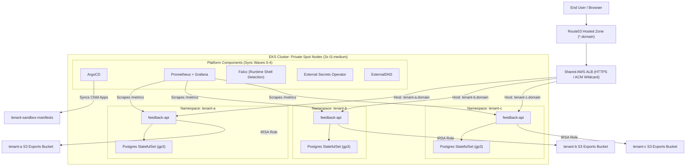

# Tenant Sandbox Manifests

GitOps repo for the Tenant Sandbox EKS portfolio/demo project.

This repo owns:

- ArgoCD app-of-apps
- platform add-ons after bootstrap
- the Go feedback API source code
- Dockerfile and Helm chart
- tenant-specific values
- monitoring dashboard
- Falco custom rule

The infra repo owns AWS infrastructure and bootstraps only AWS Load Balancer Controller plus ArgoCD.

## Tenant Model

The demo uses three tenants:

- `tenant-a`
- `tenant-b`
- `tenant-c`

Each tenant gets:

- one Kubernetes namespace
- one feedback API Deployment
- one Postgres StatefulSet
- one tenant hostname on a shared HTTPS ALB
- one tenant ServiceAccount
- namespace-scoped NetworkPolicies that admit only ALB public-subnet traffic and Prometheus scraping
- tenant-labeled Prometheus metrics

This is a portfolio/demo isolation model, not a production SaaS tenancy model.

Public ingress uses AWS ACM for ALB TLS and ExternalDNS with Route 53. cert-manager remains available for future in-cluster certificate use, but it is not used for ALB listener certificates.

## Architecture



## Local Development

Run the API locally with a local Postgres instance or connect to a test database. The Kubernetes deployment is driven by Helm values under `apps/feedback-api/chart/values`.

```bash
cd apps/feedback-api
go test -v ./...
go run ./cmd/server
```

## GitOps Bootstrap

1. Configure your AWS Account ID across all manifests:
   ```bash
   ./scripts/set-aws-account.sh <YOUR_12_DIGIT_AWS_ACCOUNT_ID>
   ```

2. Push this repository to your GitHub remote.

3. Trigger the `app-release` GitHub Actions workflow once to build and push the first container image to ECR and set image tags in Helm values.

4. After ArgoCD is installed by Terraform in the infrastructure repository:
   ```bash
   kubectl apply -f argocd/root-app.yaml
   ```

ArgoCD reconciles the root application and triggers all child applications in sync-wave order (cert-manager → external-dns & external-secrets → monitoring & falco → dashboards → tenants).

## Demo Checks

Isolation checks to capture in the final README:

- Tenant A API cannot connect to Tenant B Postgres.
- Tenant A ServiceAccount cannot read Tenant B export bucket.
- Cross-namespace pod traffic is denied by default.
- Prometheus shows metrics separated by the `tenant` label.
- Falco emits an alert when a shell is opened inside a tenant pod.

## Cost Notes

This repo intentionally uses in-cluster Postgres per tenant to avoid RDS cost during a one-shot portfolio demo. Data persistence uses PVCs, but the database setup is deliberately lightweight.
