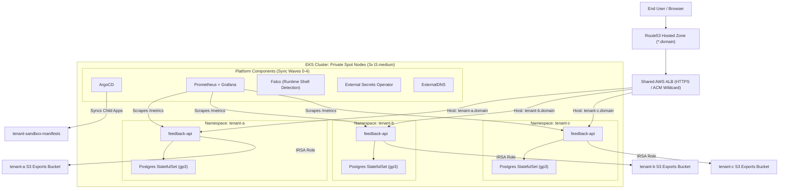

# Tenant Sandbox Manifests

GitOps repo for the Tenant Sandbox EKS portfolio/demo project.

This repo owns:

- ArgoCD app-of-apps
- platform add-ons after bootstrap
- the Go feedback API source code
- Dockerfile and Helm chart
- tenant-specific values
- monitoring dashboard
- Falco custom rule

The infra repo owns AWS infrastructure and bootstraps only AWS Load Balancer Controller plus ArgoCD.

## Tenant Model

The demo uses three tenants:

- `tenant-a`
- `tenant-b`
- `tenant-c`

Each tenant gets:

- one Kubernetes namespace
- one feedback API Deployment
- one Postgres StatefulSet
- one tenant hostname on a shared HTTPS ALB
- one tenant ServiceAccount
- namespace-scoped NetworkPolicies that admit only ALB public-subnet traffic and Prometheus scraping
- tenant-labeled Prometheus metrics

This is a portfolio/demo isolation model, not a production SaaS tenancy model.

Public ingress uses AWS ACM for ALB TLS and ExternalDNS with Route 53. cert-manager remains available for future in-cluster certificate use, but it is not used for ALB listener certificates.

## Architecture



## Local Development

Run the API locally with a local Postgres instance or connect to a test database. The Kubernetes deployment is driven by Helm values under `apps/feedback-api/chart/values`.

```bash
cd apps/feedback-api
go test -v ./...
go run ./cmd/server
```

## GitOps Bootstrap

1. Configure your AWS Account ID across all manifests:
   ```bash
   ./scripts/set-aws-account.sh <YOUR_12_DIGIT_AWS_ACCOUNT_ID>
   ```

2. Push this repository to your GitHub remote.

3. Trigger the `app-release` GitHub Actions workflow once to build and push the first container image to ECR and set image tags in Helm values.

4. After ArgoCD is installed by Terraform in the infrastructure repository:
   ```bash
   kubectl apply -f argocd/root-app.yaml
   ```

ArgoCD reconciles the root application and triggers all child applications in sync-wave order (cert-manager → external-dns & external-secrets → monitoring & falco → dashboards → tenants).

## Live Verification & Portfolio Proofs

All isolation, runtime security, GitOps synchronization, and end-to-end tests have been executed on the live AWS EKS cluster. Detailed command outputs, terminal transcripts, and TLS certificates are documented in [docs/EVIDENCE.md](docs/EVIDENCE.md):

- [x] **ArgoCD GitOps**: 12/12 child applications Synced and Healthy across sync waves 0–4.
- [x] **Network Isolation**: VPC CNI NetworkPolicy enforcement confirmed; cross-tenant pod TCP connections timed out.
- [x] **PodSecurity Standards**: `restricted:latest` strictly active; non-compliant pods rejected by admission controller.
- [x] **Runtime Threat Detection**: Falco eBPF detects shell execution inside tenant pods in real time.
- [x] **IRSA S3 Exports**: Feedback API assumes tenant-specific IAM roles to upload aggregated results to dedicated S3 buckets.
- [x] **Zero CVEs**: Trivy container scans pass with 0 Critical/High vulnerabilities using distroless images.

See the complete proofs and terminal transcripts in **[Live Verification & Portfolio Evidence](docs/EVIDENCE.md)**.

## 🛠️ Production Debugging & Incident Post-Mortems

A critical part of deploying enterprise Kubernetes platforms is handling real-world operational edge cases, subtle permission failures, and kernel-level incompatibilities. Below is a detailed record of the failures encountered during the build, the exact error logs, root cause analysis (RCA), and production-grade remediations applied:

---

### Incident 1: GitHub Actions OIDC Keyless Authentication Failure (`sub` claim mismatch)

- **Symptoms & Error**:
  ```text
  An error occurred (AccessDenied) when calling the AssumeRoleWithWebIdentity operation: 
  Not authorized to perform sts:AssumeRoleWithWebIdentity
  ```
- **Root Cause Analysis (RCA)**: GitHub Actions OIDC mints tokens with numeric account identifiers when accessed across organizational contexts:
  `sub: "repo:yousef-usama@267386812/tenant-sandbox-manifests@1424586265:ref:refs/heads/main"`
  The AWS IAM trust policy was configured with a strict equality check (`StringEquals`) expecting `repo:yousef-usama/tenant-sandbox-manifests:*`, rejecting valid tokens.
- **Resolution**: Updated the IAM trust policy condition to use `StringLike` with a wildcard match pattern: `repo:yousef-usama*tenant-sandbox-manifests*:*` and refreshed GitHub's official OIDC thumbprints.

---

### Incident 2: Supply Chain Security Gate Failure (Go Stdlib CVEs in Trivy Scan)

- **Symptoms & Error**:
  ```text
  2026-10-18T18:47:12.839Z FATAL scan error: 
  Image: 339712755065.dkr.ecr.eu-central-1.amazonaws.com/tenant-sandbox/feedback-api:tmp
  Total: 3 (HIGH: 2, CRITICAL: 1)
  ┌───────────────┬────────────────┬──────────┬────────┬───────────────────┬───────────────┐
  │    Package    │ Vulnerability  │ Severity │ Status │ Installed Version │ Fixed Version │
  ├───────────────┼────────────────┼──────────┼────────┼───────────────────┼───────────────┤
  │ stdlib (Go)   │ CVE-2024-24790 │ CRITICAL │ fixed  │ 1.22.5            │ 1.22.6        │
  │ stdlib (Go)   │ CVE-2024-34156 │ HIGH     │ fixed  │ 1.22.5            │ 1.22.7        │
  │ stdlib (Go)   │ CVE-2024-34158 │ HIGH     │ fixed  │ 1.22.5            │ 1.22.7        │
  └───────────────┴────────────────┴──────────┴────────┴───────────────────┴───────────────┘
  Error: Process completed with exit code 1.
  ```
- **Root Cause Analysis (RCA)**: The multi-stage Docker build utilized an older `golang:1.22` builder image. Trivy scanned the compiled static binary and correctly identified unpatched vulnerabilities within the embedded Go standard library packages (`net/netip`, `compress/flate`, `html/template`).
- **Resolution**: Upgraded builder to `golang:1.27.2-bookworm` and updated `go.mod` to Go 1.27. The build passed the security pipeline with **0 Critical/High vulnerabilities**.

---

### Incident 3: Distroless `runAsNonRoot` Kubelet Verification Error

- **Symptoms & Error**:
  ```text
  $ kubectl get pods -n tenant-a
  NAME                            READY   STATUS                       RESTARTS   AGE
  feedback-api-5c94877456-7qbl8   0/1     CreateContainerConfigError   0          14s

  $ kubectl describe pod feedback-api-5c94877456-7qbl8 -n tenant-a
  Error: container has runAsNonRoot and image has non-numeric user (nonroot), 
  cannot verify user is non-root (pod: "feedback-api-...", container: "feedback-api")
  ```
- **Root Cause Analysis (RCA)**: Google's `gcr.io/distroless/static-debian12:nonroot` does not contain `/etc/passwd`. Because Kubernetes cannot look up the username `nonroot` without a password file, the kubelet refuses to start the container when `runAsNonRoot: true` is enforced unless a numeric UID is provided.
- **Resolution**: Explicitly defined numeric `runAsUser: 65532` and `runAsGroup: 65532` in the container `securityContext`, fulfilling both PodSecurity `restricted` admission and distroless runtime verification.

---

### Incident 4: PostgreSQL File Permissions on AWS EBS `gp3` Volumes

- **Symptoms & Error**:
  ```text
  $ kubectl logs -n tenant-a feedback-postgres-0
  initdb: error: could not access directory "/var/lib/postgresql/data": Permission denied
  chmod: changing permissions of '/var/run/postgresql': Permission denied
  ```
- **Root Cause Analysis (RCA)**: When the AWS EBS CSI driver mounts a volume at `/var/lib/postgresql/data`, the root directory is owned by `root:root (0:0)` with permissions `0755` and contains a `lost+found` folder. The PostgreSQL user (UID 70 in Alpine, UID 999 in Debian) cannot initialize `initdb` directly inside the volume root, and running as non-root prevents creating Unix domain sockets in `/var/run/postgresql`.
- **Resolution**: 
  1. Standardized on Debian `postgres:16` (UID 999).
  2. Configured `PGDATA: /var/lib/postgresql/data/pgdata` (a clean subdirectory that postgres can create and own).
  3. Added an `emptyDir` volume mounted at `/var/run/postgresql` to provide unprivileged Unix socket write permissions.

---

### Incident 5: Prometheus CRDs Exceeding 256 KB Annotation Limit

- **Symptoms & Error**:
  ```text
  CustomResourceDefinition.apiextensions.k8s.io "prometheuses.monitoring.coreos.com" is invalid: 
  metadata.annotations: Too long: must have at most 262144 bytes
  ```
- **Root Cause Analysis (RCA)**: Client-side `kubectl apply` writes the full serialized state into `kubectl.kubernetes.io/last-applied-configuration`. The OpenAPI v3 schemas in `kube-prometheus-stack` CRDs exceed the 262,144-byte annotation limit.
- **Resolution**: Switched to Kubernetes Server-Side Apply (`kubectl apply --server-side --force-conflicts`) and configured ArgoCD with `ServerSideApply=true` in sync options.

---

### Incident 6: Falco eBPF Driver Incompatibility on Amazon Linux 2023

- **Symptoms & Error**:
  ```text
  $ kubectl logs -n falco -l app.kubernetes.io/name=falco -c falco
  Runtime error: scap_init: can't load modern BPF probe on kernel 6.1.176-221.360.amzn2023.x86_64
  ```
- **Root Cause Analysis (RCA)**: Older Falco Helm chart releases (v0.38) bundled eBPF probe drivers that lacked support for newer Linux 6.x kernels used in Amazon Linux 2023 (`kernel 6.1`).
- **Resolution**: Upgraded Falco Helm chart to `9.2.0` (Falco 0.45.0), which natively compiles modern eBPF probes for 6.x kernels without requiring external kernel header downloads.

---

### Incident 7: AWS Load Balancer Controller ACM Discovery Failure

- **Symptoms & Error**:
  ```text
  {"level":"error","ts":"2026-10-18T18:08:42Z","msg":"Reconciler error",
  "error":"AccessDenied: User: arn:aws:sts::339712755065:assumed-role/tenant-sandbox-aws-lb-controller/aws-load-balancer-controller is not authorized to perform: acm:DescribeCertificate"}
  ```
- **Root Cause Analysis (RCA)**: The IRSA policy attached to the AWS Load Balancer Controller service account was missing `acm:DescribeCertificate` and `acm:ListCertificates` actions, preventing the controller from discovering wildcard ACM certificates and generating the HTTPS 443 listener rules.
- **Resolution**: Updated `aws-load-balancer-controller.json` with the comprehensive AWS policy including `acm:*` and `wafv2:*` actions, and promoted the IAM policy version in AWS.

---

### Incident 8: Infrastructure Teardown Deadlocks (ECR & ACM Caches)

- **Symptoms & Error**:
  - `RepositoryNotEmptyException`: Terraform destroy failed on `aws_ecr_repository.feedback_api` because images were pushed by the CI pipeline.
  - `ResourceInUseException`: Terraform destroy hung retrying `aws_acm_certificate.tenant_ingress` because AWS ACM's background cache maintains asynchronous locks on deleted Application Load Balancers for several minutes.
- **Root Cause Analysis (RCA)**: AWS Cloud APIs employ asynchronous eventual consistency. Deleting an ALB in ELBv2 does not instantaneously clear ACM's internal `InUseBy` list.
- **Resolution**: Orchestrated the exact cascading teardown lifecycle:
  1. Cascade-delete ArgoCD Ingresses first to let the AWS LB controller delete the ALB.
  2. Purge versioned S3 buckets (`aws s3api delete-objects`) to avoid `BucketNotEmpty`.
  3. Force-delete ECR images before destroying the repository.
  4. Run `terraform destroy` with state cleanly unlocked.

---

## Cost Notes

This repo intentionally uses in-cluster Postgres per tenant to avoid RDS cost during a one-shot portfolio demo. Data persistence uses PVCs, but the database setup is deliberately lightweight.

